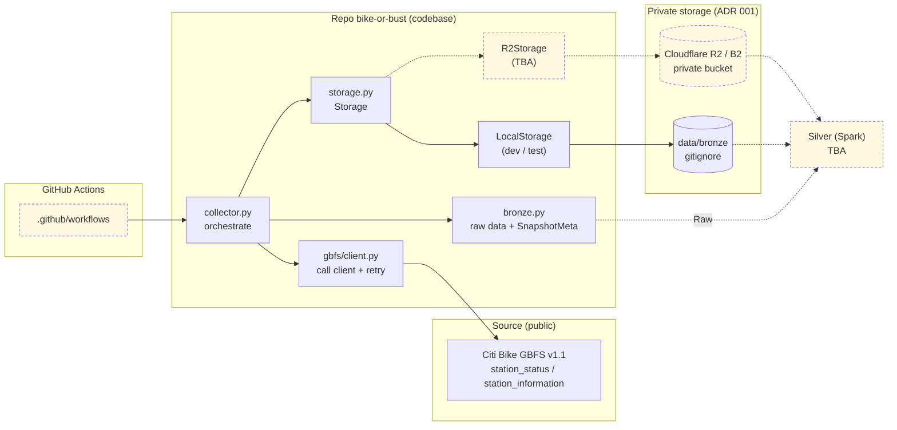

# ADR-001: Where raw collector data is persisted

- Date: 2026-11-05
- Status: [Accepted]
- Author: [Jamie]

## Context
- GitHub Actions runners are ephemeral, so the collector must push snapshots somewhere.
- The Citi Bike Data Sharing Policy forbids hosting, publishing or distributing the Data "as a stand-alone dataset"; analyses and reports using it as source material for non-commercial purposes are allowed.
- I'm economically tied, the cheaper (actually, the free) the better.

## Decision
- Raw snapshots are never committed to this repo and never stored anywhere publicly readable
- Raw data goes to a **private Cloudflare R2 bucket**. One small object per snapshot, so there is no git-history growth.
- Alternative considered: Backblaze B2. Comparable free tier and cheaper beyond it, but egress is free only up to 3x stored data and silver will re-read bronze often. R2 has no egress fee.
- Long-running jobs upload periodically (e.g. hourly), not only at the end, so a cancelled or crashed job loses at most one upload interval.
- Published in the public repo: code, docs, charts, small aggregates, metrics, tiny synthetic test fixtures.

## Consequences
- The collector needs storage credentials, held only in GitHub Secrets and a local `.env`.
- Cost: free at our volume. R2 free tier (checked 2026-11-05): 10 GB-month storage, 1M Class A (write) and 10M Class B (read) operations per month, free egress. Beyond that: $0.015/GB-month, $4.50 per million Class A operations.
- Volume estimate: ~73 KB per `station_status` snapshot, so ~7 MB/day at 15-minute cadence (~2.5 GB/year), ~105 MB/day at 1-minute cadence (10 GB reached in ~95 days). Write operations stay in the tens of thousands per month.
- Open: whether R2 requires a payment method on signup is not stated in the docs; check at account creation. Per the project rule, ask before adding any paid plan.
- Repo visibility and the GitHub Actions budget are a separate decision: see ADR-002.
